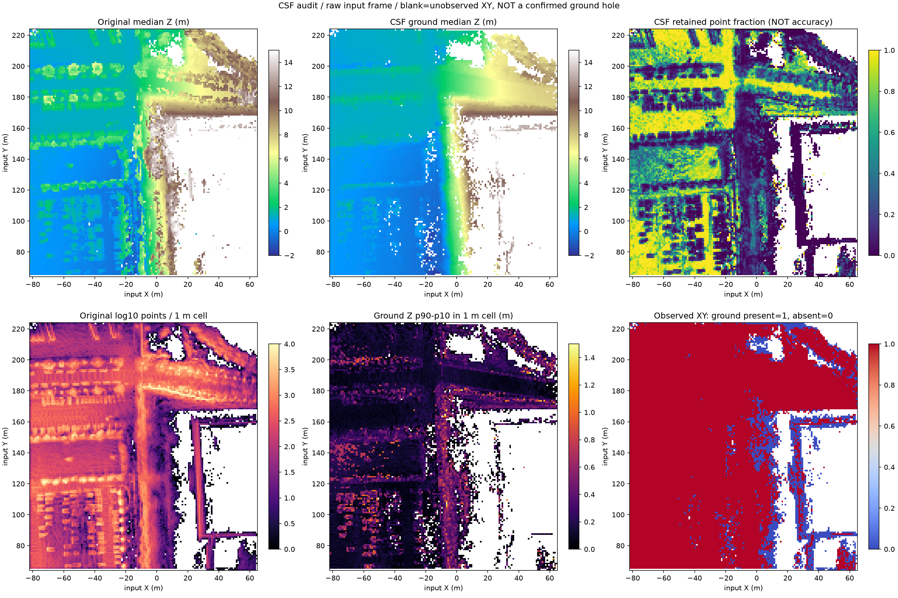
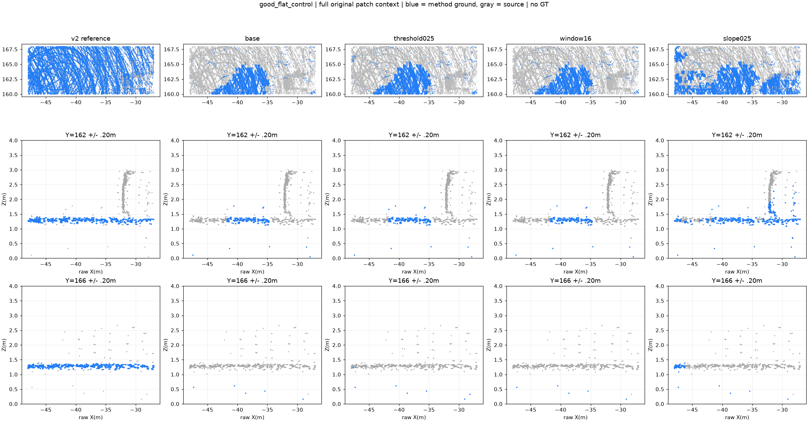
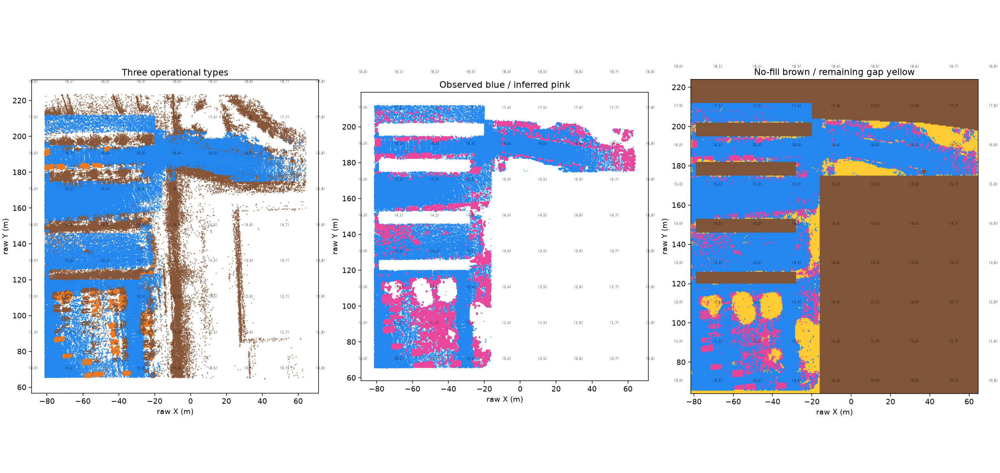
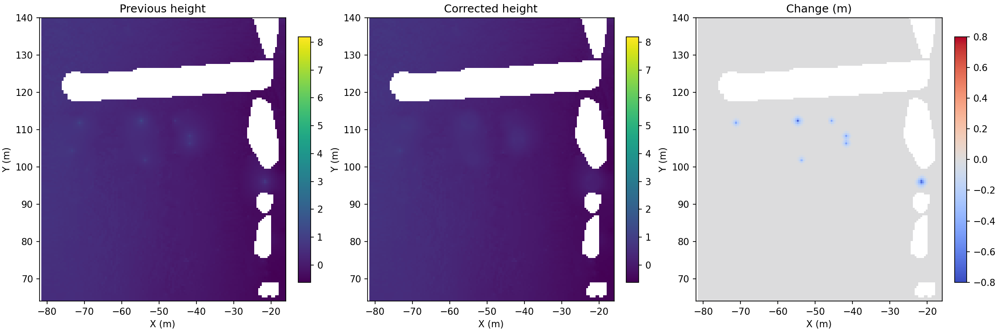
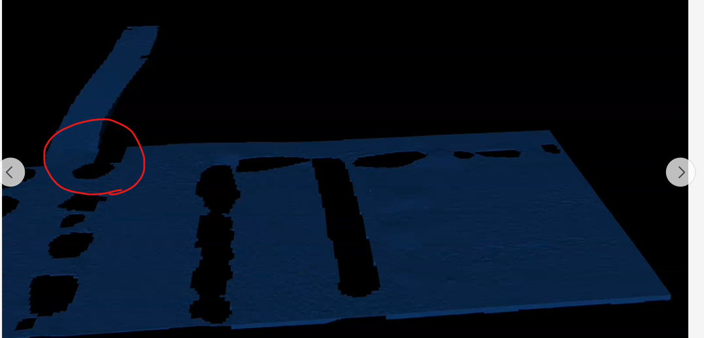

# PAIR360 S-004 ground 전달본

이 폴더는 PAIR360 데모 패치의 바닥 메시를 만드는 과정과 로컬 결과의 위치를 안내합니다. Git에는 코드·판단 설정·문서만 올리고, 원본 점군과 생성 결과는 로컬에 둡니다. 주차장과 도로의 차량 아래 빈 곳은 주변 실측 지면 높이로 메웠고, 검토한 나무·식재 구역은 메시에서 제외했습니다. **현재 좌표는 PAIR360 원시 XYZ, m, Z-up입니다. M-002 공통 원점 적용과 Isaac Lab의 Go2 보행 검증은 아직 끝나지 않았습니다.**

## 주요 실험과 판단

아래는 최종 방식에 영향을 준 다섯 가지 실험입니다. 수치는 같은 데모 패치의 기록이며, 독립적인 정답 라벨에 대한 정확도가 아닙니다.
그림은 각 실험 때 저장한 진단 자료입니다. `v2`·`v7` 표기가 있는 그림은 최종 `v8` 메시가 아닌 중간 단계입니다.

| 실험 | 확인한 문제와 결과 | 검토 그림 |
| --- | --- | --- |
| 초기 지면 추정 | 셀의 최저점 하나를 기준으로 잡자 낮은 이상치 때문에 실제 지면이 빠졌습니다. 원점에서만 지면을 넓히면 장애물 뒤의 도로가 끊겼고, 법선만 보면 차량·건물 지붕도 지면으로 들어왔습니다. 이 방식들은 최종 분류에서 제외했습니다. | 당시 화면을 확정할 수 없어 생략 |
| CSF 기준선과 천 간격 비교 | CloudCompare에서 Relief, 천 격자 0.3 m, 분류 거리 0.15 m, 최대 500회, 경사 처리 끔으로 실행했습니다. 원본 7,751,328점이 지면 2,117,644점과 비지면 5,633,684점으로 나뉘었습니다. 천 간격 0.2 m와 0.5 m도 비교했으나 반복되는 물체 잔여점은 해결되지 않았습니다. |  [천 간격별 단면](figures/csf_resolution_south_corridor.png) |
| SMRF 비교 | PDAL 2.10.2로 기준 설정과 한 항목씩 바꾼 세 설정을 비교했습니다. 평지 검토 구역에서 기존 지면 후보는 38,744점이었지만 기본 SMRF는 7,630점만 지면으로 잡았습니다. 이 값은 정답 대비 정확도가 아니라 두 결과의 차이입니다. 도로 보존과 물체 제거를 함께 개선한다는 근거가 없어 SMRF 결과로 전체를 교체하지 않았습니다. |  |
| 원본을 보며 구역 수정 | CloudCompare에서 원본과 분류 결과를 겹치고 평면·측면·단면을 돌려 봤습니다. 차량의 높은 점과 차 사이의 낮은 도로점, 나무 수관과 기둥, 경사로와 도로의 연속 높이를 구분했습니다. 그 결과 차량 아래 도로는 보간 대상으로 두고 나무·식재 부분은 제외 다각형으로 기록했습니다. 다만 사진만으로 버스 차체의 정확한 좌표를 확정하지는 못했습니다. |  |
| 표면 생성과 돌출 보정 | 0.5 m 셀의 실측 지면 높이 중앙값을 기준으로 허용 구역을 10 cm 표면으로 만들었습니다. 주차장의 고립된 돌출 후보 7곳은 주변 3.5 m 높이와 비교해 188개 셀을 보정했습니다. 최종 메시는 1,017,025정점·2,019,168삼각형입니다. |  [보정 전 v7 표면](figures/surface_v7.png) |

CSF의 0.3 m는 뒤집은 천의 격자 간격이고, 0.15 m는 천과 점 사이에서 지면으로 허용하는 거리입니다. 500회는 천 계산의 반복 상한이며 천의 물리적 크기가 아닙니다. 이 설정은 주차장 중심의 출발점으로 썼습니다. SMRF는 `cell=0.5`, `window=8`, `slope=0.15`, `threshold=0.15`, `scalar=1.25`, `cut=0`을 기준으로 threshold 0.25, window 16, slope 0.25를 각각 시험했습니다. 3DMASC 학습 분류는 하지 않았습니다.

## 최종 적용 방식과 로컬 결과

| 단계 | 최종 설정·파일 |
| --- | --- |
| 기준 입력 | `input/original.ply`에 원본 데모 패치 7,751,328점을 보관했습니다. 입력 SHA-256은 `checksums.json`에서 확인할 수 있습니다. |
| 분류·구역 | `review/classification.npz`와 `review/design_policy.npz`를 사용했습니다. 허용·제외 구역의 좌표는 `tools/map/continuous_ground_20261104_v7.json`에 있습니다. CSF는 첫 분류에 썼고 SMRF 결과로 전체 마스크를 바꾸지 않았습니다. |
| 지면 높이 | 실측 지면의 높이를 0.5 m 셀마다 중앙값으로 모았습니다. 차량 점은 제외했고, 허용한 빈 셀만 주변 높이로 채웠습니다. |
| 표면·보정 | 채운 높이를 10 cm 격자 삼각형 메시로 만들었습니다. `smooth_local_ground_v8.py`는 주차장 돌출 후보를 높이 잔차 0.15 m 기준으로 찾아 국소 보정합니다. |
| 점군·메시 | 로컬 결과는 `result/ground.ply`, `result/non_ground.ply`, `result/ground_mesh.ply`에 있습니다. |
| 시뮬레이터 | MuJoCo 장면은 `result/mujoco/scene.xml`과 `hfields/`의 320개 타일로 구성됩니다. Isaac 장면은 `result/isaac/scene.usda`와 `ground_collision.usdc`를 함께 사용합니다. |
| 좌표 | `frame.json`에 원본 XYZ를 그대로 쓴다고 기록했습니다. 단위는 m, 위쪽 축은 Z이며 origin `[0,0,0]`, scale `1`, 회전 없음입니다. |

표의 점군·메시·시뮬레이터 파일은 로컬에만 있습니다. Git에는 이 파일들의 위치와 해시, 생성 코드를 남깁니다.

## 수정 예정인 경사로 접속부

보행팀 피드백에서 노천극장으로 가는 길과 주차장 도로가 만나는 곳에 작은 구멍이 지적됐습니다. 아래 빨간 원 부분입니다. **현재 로컬 메시에도 남아 있으며, 다음 수정 때 원본 낮은 지면과 접속부의 허용 마스크를 다시 확인해 메울 예정입니다.** 이 수정 전에는 해당 접속부의 연속 보행을 확인했다고 표시하지 않습니다.



## 파일을 고르는 법

| 파일 | 용도 |
| --- | --- |
| `input/original.ply` | 분류 전 데모 패치 7,751,328점입니다. CloudCompare BIN에서 저장한 작업 입력이며 전체 시퀀스 PCD는 아닙니다. |
| `review/classification.npz`, `protocol.json` | 0.5 m 격자·점별 검토 결과와 판단 기록입니다. 자동 분류의 정답 라벨은 아닙니다. |
| `review/design_policy.npz` | 식재·기둥 제외 구역을 비롯한 수동 판단이 담겨 있습니다. 메시를 다시 만들 때 필요합니다. |
| `result/ground.ply`, `non_ground.ply`, `partition.json` | 측정 원본을 지면 1,336,620점과 나머지 6,414,708점으로 나눈 파일입니다. `original_index`를 합치면 중복·누락 없이 원본이 됩니다. 비지면에는 차·나무·건물·미분류 지면이 섞여 있습니다. |
| `result/ground_mesh.ply` | 10 cm 간격의 최종 삼각형 바닥 메시입니다. 관측되지 않은 곳에 보간으로 만든 표면점도 포함합니다. |
| `result/ground_surface.npz` | 격자 높이와 허용 구역 마스크입니다. MuJoCo 높이 타일을 다시 만들 때 사용합니다. |
| `result/isaac/scene.usda`, `ground_collision.usdc` | Isaac 장면과 정적 충돌 메시입니다. 두 파일을 함께 옮겨야 합니다. |
| `result/mujoco/scene.xml`, `hfields/`, `view_mujoco.py` | MuJoCo 장면, 320개 높이 타일, 로컬 뷰어입니다. XML만 옮기면 지형이 로드되지 않습니다. |
| `frame.json`, `checksums.json` | 좌표 변환과 입력·핵심 결과의 SHA-256을 기록했습니다. |

CloudCompare에서는 `input/original.ply`, `result/ground.ply`, `result/non_ground.ply`, `result/ground_mesh.ply`를 열고 왼쪽 DB Tree의 체크박스로 하나씩 켜면 된다. `ground.ply`는 실측 지면의 보수적 부분집합이고, `ground_mesh.ply`는 차량 아래를 포함해 보간한 물리 표면이다. 바닥 메시를 확인할 때 점군과 메시를 같은 객체로 해석하지 않는다.

MuJoCo의 320개 heightfield는 나무 구멍을 유지하면서 허용된 바닥을 직사각형으로 나눈 타일 수다. 해상도가 다른 320개 버전이 아니다. Isaac USD에는 동일한 바닥의 삼각형 메시 하나를 넣고 collision approximation을 `none`으로 설정했다.

## 원본에서 메시까지

```text
원본 데모 PLY → CSF 기준선과 CloudCompare·단면 검토
              → 격자 분류·차량/나무/도로 결정 기록
              → 0.5 m 셀의 실측 지면 높이 중앙값
              → 허용된 빈 셀만 보간 → 10 cm 표면 → 삼각형 메시
              → 주차장 국소 돌출 보정 → MuJoCo heightfield·Isaac USD
```

처리 순서는 다음과 같습니다.

- CloudCompare CSF를 Relief, cloth resolution 0.3 m, classification threshold 0.15 m, 최대 500회, slope processing 끔으로 실행해 첫 지면 후보를 얻었습니다.
- SMRF 설정 네 가지를 국소 구역에서 비교했지만, 평지 누락을 확인해 최종 분류로 일괄 교체하지 않았습니다. 3DMASC는 사용하지 않았습니다.
- 자동차·버스 주변, 경사로, 도로 연결, 나무 아래를 원본과 겹쳐 보고 허용·제외 구역을 수정했습니다. 좌표 다각형은 `tools/map/continuous_ground_20261104_v7.json`에 기록했습니다.
- 분류된 실측 지면 높이만 보간의 기준으로 삼았습니다. 차량 점은 높이 기준에서 제외했습니다.

최종 생성에는 저장소의 Python 3.12 `uv` 환경이 필요하다. 저장소 루트에서 실행한다. 기존 출력은 덮어쓰지 않으므로 `--out`에는 새 경로를 준다.

```bash
uv sync --locked
uv run python tools/map/reproduce_s004_final.py --out /tmp/s004-rebuild
```

이 명령은 `build_continuous_ground_v5.py`로 검토 격자를 표면으로 만들고, `smooth_local_ground_v8.py`로 주차장의 고립된 돌출 후보 7곳을 국소 보정한다. `export_s004_layers.py`는 최종 높이에서 0.15 m 이내인 실측 지면점을 나머지 점과 나눈다. 이어 `export_final_sim.py`가 MuJoCo·USD를 만든다. 실행 전에 입력 해시를 검사하고, 재생성한 메시와 두 점군의 SHA-256을 전달본과 대조한다. MuJoCo 출력에는 허용된 면·나무 구멍·타일 이음새 광선 검사와 낙하 접촉 검사가 포함된다.

## 이후 작업

- 피드백 사진에 표시된 노천극장 접근 경사로 접속부의 구멍을 원본 점군과 높이 단면으로 다시 확인하고 메시를 수정합니다.
- 현재 `non_ground.ply`에 함께 들어 있는 자동차·나무·건물·미분류 점을 나눕니다. 나무 아래의 지면과 수관, 차량 아래의 추정 지면과 차체를 구분해 `cars.ply`, `other.ply`, `unclassified.ply`의 범위와 기준을 정합니다. 현재 파일은 이런 의미 분류를 완료한 결과가 아닙니다.
- M-002 공통 origin·회전·scale을 확인한 뒤 메시와 시뮬레이터 장면에 같은 변환을 적용합니다. Isaac Lab의 실제 위치·스케일·충돌·보행 검증은 그다음에 진행합니다.

서쪽 통로의 약 0.3–0.6 m 이중 지면과 차량 아래 보간 높이는 독립적인 정답 자료로 확인하지 못했습니다. 차량 아래의 새 표면은 주변 지면에서 추정한 값입니다.

## 출처와 라이선스

원본 데이터는 경희대학교 AIRLAB의 [PAIR360 데이터셋](https://airlabkhu.github.io/PAIR-360-Dataset/)이다. 데이터셋 페이지는 Open Database License에 따른 배포·수정과 출처 표시, 공개 파생 데이터의 동일 라이선스 적용을 안내한다. Kim, Geunu 외, “PAIR360: A Paired Dataset of High-Resolution 360° Panoramic Images and LiDAR Scans,” *IEEE Robotics and Automation Letters*, 2024를 인용한다. 이 폴더의 원본 점군과 파생 점군·지형 자료에는 해당 데이터 라이선스가 적용된다. 저장소 Python 코드의 SPDX 표기는 Apache-2.0이다.

원본 점군과 최종 PLY·NPZ·USD·MuJoCo 높이 타일은 Git에서 제외합니다. 따라서 Git만 받은 팀원은 이 안내의 경로에 결과 파일이 없으며, 로컬 전달본을 별도로 받아야 시뮬레이터 장면을 열 수 있습니다. 이 저장소의 재현 명령도 검토 입력인 `input/original.ply`, `review/classification.npz`, `review/design_policy.npz`가 준비된 상태에서 실행합니다.
