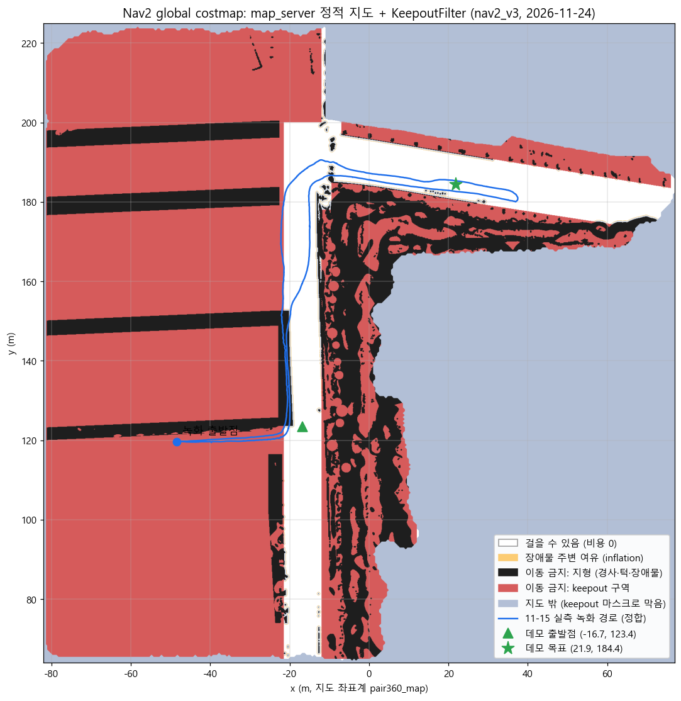

# PAIR360 데모 구역 Nav2 지도와 금지 구역

S-017 "통행 가능 영역 분리"의 Nav2 입력입니다. Nav2가 길을 찾을 때 쓰는 **정적 지도**와 **금지 구역 마스크**를 담았습니다. 2026-11-24 기준입니다.

<p></p>

그림은 Nav2(Jazzy)에 두 파일을 실제로 넣어 받은 global costmap입니다.

- **흰색**: 걸을 수 있는 땅입니다. 직선도로와 경사로뿐입니다.
- **검정**: 지형상 못 가는 곳입니다.
- **빨강**: 금지 구역입니다.
- **회청색**: 지도 밖입니다.
- **파란 선**: 11-15 실측 녹화 경로입니다. 사람이 센서를 들고 걸은 경로이며, 로봇의 계획 경로가 아닙니다.

## 파일

| 파일 | 쓰는 곳 | 값 |
| --- | --- | --- |
| `map.yaml`, `map.png` | `map_server` → costmap `static_layer` | 254 걸을 수 있는 땅, 0 이동 금지(경사·턱·장애물·나무), 205 지도 밖 |
| `keepout_mask.yaml`, `keepout_mask.png` | `filter_mask_server` → `KeepoutFilter` | 0 금지 구역과 지도 밖 전체, 254 그 밖 |
| `keepout_zones.json` | 금지 구역 정의(사람이 정한 다각형) | 구역별 이름·이유·결정 |
| `nav2_params.example.yaml` | Nav2 설정 예 | map_server, KeepoutFilter, global costmap |
| `figures/` | 확인 그림 | `nav2_costmap_check.png`, 입력 미리보기 `preview.png` |

- **좌표**: 지도 좌표계(`pair360_map`, PAIR360 지도 v1·v2·v3 공통, m, z 위쪽)입니다. 0.1 m 격자, 1611 × 1616칸이며 원점(왼쪽 아래 모서리)은 (−82.55, 63.45)입니다.
- **걸을 수 있는 면적**: 2,218 m²입니다.
- **형식**: 이미지는 무손실 PNG입니다. 원래 만든 PGM과 픽셀이 같고, Nav2 비용지도도 같게 나왔습니다.

## 금지 구역

`keepout_zones.json`의 `decision: keepout` 구역에 지도 밖 전체를 더한 것입니다. 구역은 2026-11-22에 PM이 정했고, 11-23에 경계를 수정했습니다.

| 번호 | 구역 | 이유 |
| --- | --- | --- |
| 1 | 주차장 전체 | 차가 드나듭니다. 동쪽 경계는 직선도로 서쪽 끝 x −21.5입니다 |
| 3 | 직선도로 북쪽 끝 | 경사로 입구보다 북쪽이라 데모 경로 밖입니다 |
| 4 | 직선도로 동쪽 나무·화단 | 나무 사이 빈 바닥으로 지름길을 낼 수 있습니다 |
| 5 | 경사로 북쪽 연석 너머 | 인도와 둑입니다 |
| 7 | 경사로 남쪽 수풀 | 나무와 수풀 사이 빈 바닥이 섞여 있습니다 |

구역 2(출발점 남쪽 직선도로)와 6(목표점 너머 경사로)은 허용입니다. 데모 출발점은 (−16.7, 123.4), 목표는 (21.9, 184.4)입니다.

## Nav2에 넣을 때 주의할 점

1. **올리는 순서**: 금지 구역 마스크가 비용지도보다 늦게 도착하면 첫 전체 갱신에서 빠지고, 금지 구역이 일부(시험에서 7%)만 반영됩니다. `filter_mask_server`·`costmap_filter_info_server` → costmap → `map_server` 순서로 올리면 100% 반영됩니다.
2. **`free_thresh: 0.1`**: map_server는 205를 점유 확률 (255 − 205) / 255 = 0.196으로 읽습니다. 흔히 쓰는 0.25로 두면 지도 밖이 "빈 땅"이 됩니다.
3. **지도 밖도 마스크에 넣은 이유**: 시험한 순서에서는 static layer가 지도 밖 칸을 비용 0으로 남겼습니다. 경로 계획기는 기본 설정에서 "모름" 칸을 지나갈 수 있으므로 마스크로 막았습니다.
4. **`map_topic: /map`은 절대 이름으로**: costmap이 네임스페이스 안에 있으면 상대 이름 `map`이 `/global_costmap/map`이 되어 지도를 받지 못합니다.

## 확인 방법

```bash
tools/map/check_nav2_keepout.sh sim_scenes/pair360_nav2
```

팀 ROS 이미지 안에서 Nav2 패키지를 apt로 설치하고 위 순서로 띄운 뒤, 비용지도에서 금지 구역과 지도 밖이 모두 통행 불가인지 검사합니다. 이미지 자체는 바꾸지 않으며 약 5분 걸립니다.

2026-11-24 결과는 다음과 같습니다.

- 금지 구역과 지도 밖: 100% 통행 불가
- 걸을 수 있는 칸: 94%가 비용 0(나머지는 장애물 가장자리의 여유 구간)

이 검사는 비용지도가 맞게 만들어지는지만 봅니다. 경로 계획과 실기 주행은 확인하지 않았으며, G-009(sim–Nav2 연결)에서 다룹니다.

## 출처와 생성

- **입력**: PAIR360 T1 주차장 점군(v1, Kim et al., *PAIR360*, IEEE RA-L 2024, ODbL 1.0), 팀 FAST-LIO 촬영 점군(v2, 2026-11-15), 둘을 합친 map_v3와 지형 메시 mesh_v3(2026-11-18)입니다.
- **생성**: 장승민 로컬 `pair360-map` 파이프라인 11단계(`s11_nav2.py`, Python 3.11, NumPy·Matplotlib)입니다. mesh_v3의 지면 격자와 이동 금지 heightfield에 `keepout_zones.json`을 적용했고, PGM을 Pillow로 PNG로 바꿨습니다. 생성 코드는 아직 이 저장소에 없으며, 지형 생성 과정은 S-017 Notion 페이지에 있습니다.
- **라이선스**: 지도 이미지는 PAIR360(ODbL 1.0)에서 파생한 데이터입니다. 공유할 때 원저자·논문·변경 내용을 함께 밝힙니다. 설정 파일과 도구는 Apache-2.0, 이 문서는 CC BY 4.0입니다.

## 한계

- 주차장에 차 약 25대가 장애물로 남아 있습니다. 금지 구역이라 데모 경로에는 영향이 없습니다.
- 지도 정합 뒤에도 국소적으로 0.5~0.8 m 어긋난 곳이 있습니다.
- 공통 원점(M-002)은 아직 적용하지 않았습니다. 바뀌면 지도도 다시 만듭니다.
